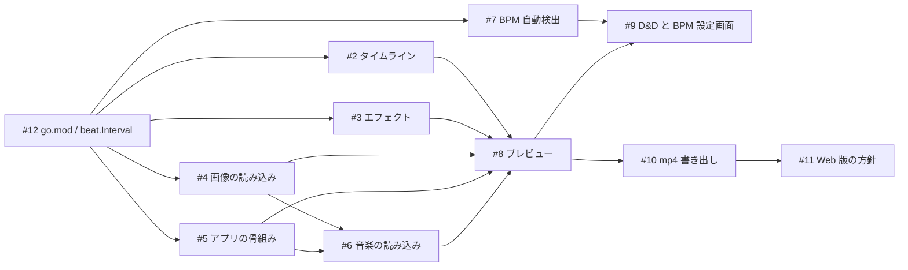

# 要件

要求（[01-needs.md](01-needs.md)）を満たすために、アプリが満たすべき条件。詳細な入出力や計算規則は [03-specification.md](03-specification.md) に書く。

## 機能要件

| ID | 要件 | 対応する要求 | Issue | 段階 |
| --- | --- | --- | --- | --- |
| FR-01 | 指定したフォルダから、切り替えに使う画像（PNG / JPEG）をファイル名の自然順で読み込める | N-01 | #4 | MVP |
| FR-02 | 音楽ファイル（mp3 / wav）を読み込み、再生・解析・書き出しに使える | N-01 | #6 | MVP |
| FR-03 | BPM を数値で手動指定できる | N-02 | #8、#9 | MVP |
| FR-04 | 曲から BPM と最初の拍の位置を自動で検出できる。検出できない場合は手動指定に切り替えられる | N-02 | #7 | MVP |
| FR-05 | BPM・最初の拍の位置・切り替え間隔（1 / 2 / 4 拍）に従って、拍に合わせて画像を順に切り替える。画像が足りなければ先頭から繰り返す | N-01 | #2、#12 | MVP |
| FR-06 | 拍に合わせて、フラッシュ・ズーム・シェイクのエフェクトを自動でかける。同じ設定なら毎回同じ結果になる | N-03 | #3 | MVP |
| FR-07 | 音楽を再生しながら、画像の切り替えとエフェクトをリアルタイムにプレビューできる。再生・一時停止・シークができる | N-04 | #8 | MVP |
| FR-08 | ドラッグ＆ドロップで素材を読み込み、BPM（自動 / 手動）と切り替え間隔を画面上で設定できる。読み込み中・エラーを画面に表示する | N-01、N-02 | #9 | MVP |
| FR-09 | プレビューと同じ見た目の動画を mp4（H.264 + AAC）で書き出せる。進捗の表示とキャンセルができる | N-05 | #10 | MVP |
| FR-10 | ブラウザ（WebAssembly）で動作する | N-06 | #11 | 次段階（方針決めのみ） |

## 非機能要件

| ID | 区分 | 要件 | Issue |
| --- | --- | --- | --- |
| NFR-01 | 同期精度 | プレビューは音声の再生位置を基準に表示を決め、映像と音がずれない（フレーム数で時間を数えない） | #8 |
| NFR-02 | 再現性 | 同じ素材・設定・シードなら、プレビューと書き出しの見た目が一致する | #3、#10 |
| NFR-03 | 性能（描画） | 毎フレームの `Update` / `Draw` で画像のデコードや不要なメモリ確保をしない。表示する画像の決定は O(log n) | #2、#8 |
| NFR-04 | 性能（解析） | 3 分の曲（44.1kHz）の BPM 検出が手元で数秒以内に終わる | #7 |
| NFR-05 | テスト容易性 | ビート検出・タイムライン・エフェクト・描画の配置計算・ffmpeg 引数の組み立てなどのロジックは、Ebitengine 抜きでテストできる純粋関数にする | 全 Issue |
| NFR-06 | 依存の最小化 | 外部依存は Ebitengine のみを基本とする。ファイル選択ダイアログ・FFT・音声解析などのライブラリは追加しない。書き出しは外部コマンドの ffmpeg を使う | #4、#5、#7、#9 |
| NFR-07 | エラー時の振る舞い | 不正な入力・対応していない形式・壊れたファイル・ffmpeg が無い場合は、原因がわかるメッセージを返し、アプリは落ちない | #2、#4、#6、#7、#10 |
| NFR-08 | 対応環境 | デスクトップ（macOS / Windows / Linux）。既定の画面サイズ・出力解像度は 1280×720 | #5、#10 |

## 制約

- 言語・フレームワーク：Go + Ebitengine（`github.com/hajimehoshi/ebiten/v2`）。guigui は API が固まっていないため MVP では使わない（#5）。
- ライセンス：All Rights Reserved。外部コードの貼り付け、ライセンス不明なアセットの追加はしない。テスト用の素材ファイルはコミットせず、テスト内で生成する。
- 開発プロセス：CLAUDE.md の規約・完了の定義・安全ルールに従う。

## Issue の依存関係

