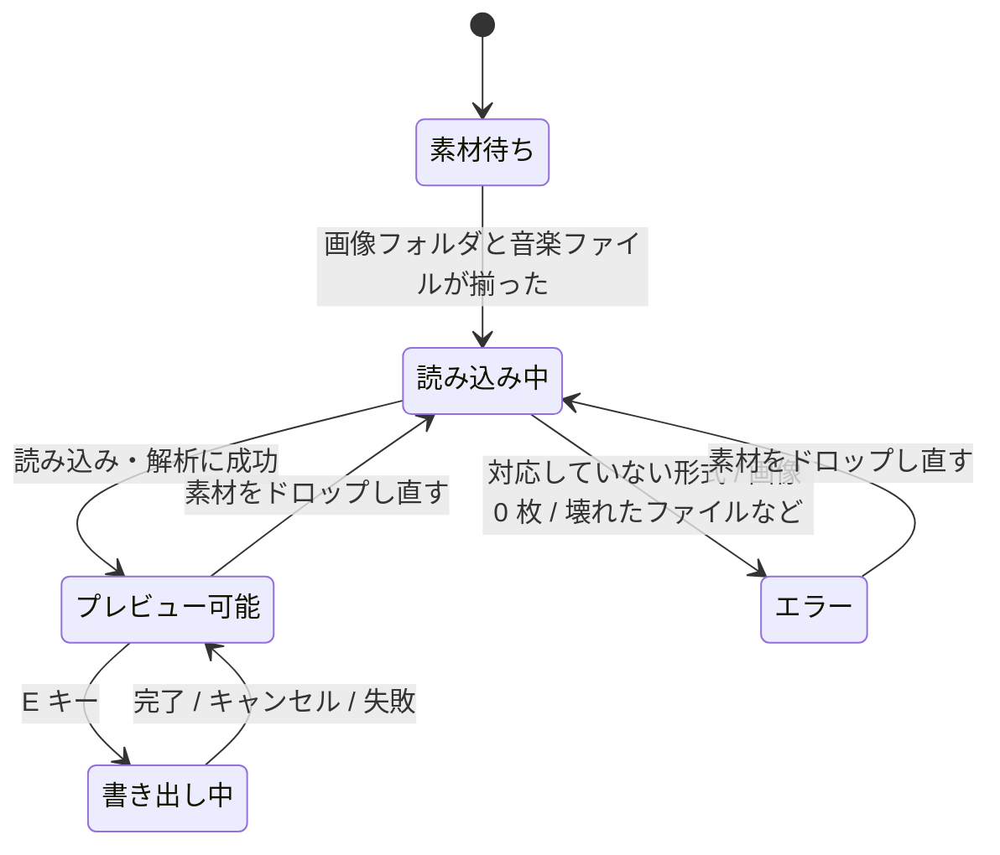

# 仕様

要件（[02-requirements.md](02-requirements.md)）をどう実現するか。各節の見出しに対応する要件 ID と Issue を書く。
「未決定」と書いた項目は推測で実装せず、Issue で決めてからここに反映する（[未決定事項](#未決定事項) にまとめてある）。

## 1. 全体構成

```text
cmd/mad-maker/        エントリポイント。コマンドライン引数の解釈とウィンドウの起動
internal/app/         ebiten.Game の実装。画面の状態遷移、入力、描画（Ebitengine 依存はここに閉じ込める）
internal/beat/        拍の長さ、BPM 自動検出（Ebitengine 非依存）
internal/timeline/    画像の切り替えタイムライン（Ebitengine 非依存）
internal/effect/      エフェクトの割り当てと状態の計算（Ebitengine 非依存）
internal/media/       画像フォルダ・音楽ファイルの読み込み
internal/export/      ffmpeg による mp4 書き出し
```

データの流れ：

```text
画像フォルダ ──> media（画像一覧・デコード） ─────────────────────┐
音楽ファイル ──> media（デコード・長さ・モノラルサンプル）          │
                   ├─> beat（BPM・オフセットの自動検出）            │
                   │      または手動指定の BPM                      │
                   └──────────────┬───────────────────────────────┤
                                  v                                 v
                    timeline（切り替えの一覧） + effect（拍ごとのエフェクト）
                                  │
                    ┌─────────────┴─────────────┐
                    v                           v
           app（プレビュー描画）          export（フレーム描画 → ffmpeg）
                    └──── 同じ描画関数を使う ────┘
```

## 2. 用語

| 用語 | 意味 |
| --- | --- |
| BPM | 1 分あたりの拍の数。正の有限な実数 |
| 拍の長さ | `beat.Interval(bpm)` = `1分 / BPM`（例：120 BPM → 500ms） |
| オフセット | 曲の先頭から最初の拍までの時間 |
| 拍番号 | オフセットを 0 拍目として数えた拍の通し番号（0 始まり） |
| 切り替え間隔 | 何拍ごとに画像を切り替えるか（1 / 2 / 4） |
| 区間（スロット） | 1 枚の画像を表示する時間の範囲 `[開始, 終了)` |
| シード | エフェクトの乱数のシード。同じシードなら同じ結果になる |

## 3. 素材の読み込み

### 3.1 画像フォルダ（FR-01 / #4）

- 入力：フォルダのパス
- 対象：直下にある拡張子 `.png` / `.jpg` / `.jpeg` のファイル（大文字小文字を区別しない）。それ以外のファイルとサブフォルダは無視する。
- 並び順：ファイル名の自然順（数字部分を数値として比較する。`img2.png` < `img10.png`）。
- デコード：標準ライブラリの `image/png` と `image/jpeg` を使う。
- エラー：
  - 対象の画像が 1 枚もない
  - 壊れた画像がある（エラーメッセージに壊れたファイル名を含める）
- 外部依存を追加しない。

### 3.2 音楽ファイル（FR-02 / #6）

- 入力：ファイルのパス
- 対応形式：`.mp3` / `.wav`（拡張子で判定）。デコードは Ebitengine の `audio/mp3` / `audio/wav` を使う。
- サンプルレート：`audio.Context` と同じ値（44100Hz または 48000Hz）にリサンプルする。どちらを使うかは #6 で決める。
- 提供する情報：
  - 曲の長さ（`time.Duration`）
  - 解析用のモノラル float32 サンプル列（値の範囲 -1〜1）
- エラー：対応していない形式、壊れたファイル。

## 4. BPM

### 4.1 手動指定（FR-03）

- コマンドライン引数 `-bpm <数値>`、または画面上で ↑ / ↓（±1）、Shift + ↑ / ↓（±0.1）で指定する。
- 有効な値は正の有限な実数。不正な値は `beat.Interval` がエラーを返す。
- 手動指定時のオフセット：未決定（[U-03](#未決定事項)）。

### 4.2 自動検出（FR-04 / #7）

- 入力：モノラルのサンプル列とサンプルレート
- 出力：推定 BPM と最初の拍の位置（オフセット）
- 方式：音量の立ち上がり（オンセット）の包絡線の自己相関など、単純な方式でよい。採用した方式と限界は PR に書く。
- 探索範囲：60〜200 BPM
- 精度：プログラムで生成したクリック音列で、90 / 120 / 150 BPM を ±1 BPM 以内で検出できる。
- 性能：3 分（44.1kHz）の曲の解析が数秒以内（ベンチマークを付ける）。
- 検出できない場合（無音など）はエラーを返す。呼び出し側は手動指定にフォールバックする。
- FFT が必要なら自前で実装し、外部依存は追加しない。

## 5. タイムライン（FR-05 / #2）

### 5.1 入力

| 項目 | 型の目安 | 制約 |
| --- | --- | --- |
| BPM | `float64` | 0 より大きい（不正ならエラー） |
| オフセット | `time.Duration` | 未決定（負の値・曲の長さ以上の値の扱いは [U-02](#未決定事項)） |
| 曲の長さ | `time.Duration` | 0 より大きい |
| 画像の枚数 | `int` | 1 以上 |
| 切り替え間隔（拍数） | `int` | 1 以上（UI で選べるのは 1 / 2 / 4） |

### 5.2 出力

切り替えの一覧。各要素は次を持つ。

| 項目 | 意味 |
| --- | --- |
| 開始時刻 | 区間の開始（含む） |
| 終了時刻 | 区間の終了（含まない） |
| 画像のインデックス | 表示する画像（0 始まり） |
| 拍番号 | 区間の開始にあたる拍の番号 |

### 5.3 計算規則

`interval = beat.Interval(BPM)`、`N = 切り替え間隔`、`k = 0, 1, 2, ...` として、k 番目の区間は次のとおり。

- 開始時刻 = `オフセット + k × N × interval`
- 終了時刻 = `min(オフセット + (k + 1) × N × interval, 曲の長さ)`
- 画像のインデックス = `k mod 画像の枚数`（画像が足りなければ先頭から繰り返す）
- 拍番号 = `k × N`
- 開始時刻が曲の長さ以上になったら打ち切る。最後の区間は拍の途中で終わってよい。

例：120 BPM、オフセット 0、曲の長さ 1.2s、画像 2 枚、間隔 1 拍

| k | 開始 | 終了 | 画像 | 拍番号 |
| --- | --- | --- | --- | --- |
| 0 | 0ms | 500ms | 0 | 0 |
| 1 | 500ms | 1000ms | 1 | 1 |
| 2 | 1000ms | 1200ms | 0 | 2 |

### 5.4 時刻から画像を引く

- 指定した時刻を含む区間を二分探索で求め、画像のインデックスを返す（O(log n)。プレビューで毎フレーム呼ぶ）。
- 次の境界の振る舞いはテストで固定する。値は未決定（[U-01](#未決定事項)）。
  - オフセットより前の時刻
  - 曲の終わりちょうど、およびそれ以降の時刻

### 5.5 エラー

BPM が 0 以下・NaN・Inf、画像 0 枚、曲の長さ 0 以下、切り替え間隔 0 以下。

## 6. エフェクト（FR-06 / #3）

### 6.1 種類

なし / フラッシュ / ズーム / シェイク

### 6.2 割り当て

- 入力：拍番号、シード
- 出力：その拍にかけるエフェクトの種類
- 同じシードと拍番号なら必ず同じ結果になる（プレビューと書き出しで一致させるため）。
- 規則は単純なものでよい（例：小節の頭 = 4 拍ごとには強めのエフェクトが乗りやすい）。採用した規則は PR に書き、マージ後にこの節へ反映する。
- エフェクトは拍ごとに割り当てる（画像の切り替え間隔とは独立）。

### 6.3 状態の計算

- 入力：エフェクトの種類、拍の開始からの経過時間、拍の長さ、（シェイクは）シード
- 出力と振る舞い：

| 種類 | 出力 | 拍の頭 | 拍の終わりまでに |
| --- | --- | --- | --- |
| フラッシュ | 白の重ね合わせの不透明度（0〜1） | 最大 | 0 に戻る |
| ズーム | 拡大率（1.0 以上） | 最大 | 1.0 に戻る |
| シェイク | x / y のずれ（ピクセル、シードで決まる） | 最大 | 0 に戻る |

- 減衰の曲線（線形・指数など）と最大値は実装で決め、PR に書く。
- Ebitengine に依存しない（標準ライブラリのみ）。

## 7. プレビュー（FR-07 / #8）

### 7.1 時刻の基準

- 表示する画像とエフェクトは、**音声の再生位置（`audio.Player.Position`）** を基準に決める。フレーム数で時間を数えない。

### 7.2 描画

- 画像はウィンドウに収まるよう、アスペクト比を保って中央に配置する。余白は黒。
- エフェクトは `internal/effect` の計算結果どおりに描画する（フラッシュ = 白の重ね合わせ、ズーム = 中心を基準に拡大、シェイク = 平行移動）。
- 画面の隅に、再生位置・BPM・現在の拍番号を表示する。
- 画像の配置矩形、エフェクトの変換行列などの計算は純粋関数にしてテストする。
- 画像は読み込み時に `ebiten.Image` へ変換しておき、毎フレームの `Draw` でデコードやメモリ確保をしない。

### 7.3 操作

| キー | 動作 |
| --- | --- |
| Space | 再生 / 一時停止 |
| ← | 5 秒戻る（0 未満にはしない） |
| → | 5 秒進む（曲の長さを超えたときの扱いは [U-04](#未決定事項)） |
| Esc | アプリを終了する |
| E | mp4 を書き出す（[9 節](#9-mp4-書き出しfr-09--10)） |

曲の終わりまで再生したときの振る舞い（停止 / ループ）は未決定（[U-04](#未決定事項)）。

## 8. 画面と状態遷移（FR-08 / #5、#9）

### 8.1 ウィンドウ

- 1280×720、タイトル「mad-maker」、リサイズ可。

### 8.2 状態遷移

画面の状態は Ebitengine に依存しない状態機械として実装し、テストする。



- 「書き出し中」の状態は #10 で追加する。
- 素材の片方だけがドロップされた場合は、もう片方を待つ（素材待ちのまま、どちらが揃っているかを表示する）。

### 8.3 素材の受け取り

- ウィンドウへのドラッグ＆ドロップ（`ebiten.DroppedFiles`）。ファイル選択ダイアログ用のライブラリは追加しない。
  - フォルダ → 画像フォルダとして扱う
  - `.mp3` / `.wav` → 音楽ファイルとして扱う
- コマンドライン引数（[8.5](#85-コマンドライン引数)）で指定された場合は、ドラッグ＆ドロップを省略して読み込み中から始める。

### 8.4 設定項目

| 項目 | 選択肢 | 既定値 |
| --- | --- | --- |
| BPM のモード | 自動検出 / 手動指定 | 未決定（[U-05](#未決定事項)） |
| 手動 BPM | ↑ / ↓ で ±1、Shift 同時押しで ±0.1 | 自動検出の結果、または `-bpm` の値 |
| 切り替え間隔 | 1 / 2 / 4 拍 | 未決定（[U-05](#未決定事項)） |

自動検出に失敗した場合は、手動指定に切り替えてエラー内容を表示する。

### 8.5 コマンドライン引数

| 引数 | 意味 | Issue |
| --- | --- | --- |
| `-images <フォルダ>` | 画像フォルダ | #8 |
| `-audio <ファイル>` | 音楽ファイル | #8 |
| `-bpm <数値>` | BPM（手動指定） | #8 |
| `-out <ファイル>` | 書き出し先 | #10 |

## 9. mp4 書き出し（FR-09 / #10）

### 9.1 出力

| 項目 | 値 |
| --- | --- |
| 形式 | mp4（映像 H.264、音声 AAC） |
| 解像度 | 1280×720（既定値） |
| フレームレート | 30fps（既定値） |
| 保存先 | `-out` の値。無ければ音楽ファイルと同じフォルダ（ファイル名の規則は [U-06](#未決定事項)） |

### 9.2 処理

1. フレーム i の時刻 `i / fps` について、プレビューと**同じ描画関数・同じシード**でフレームを描画する。
2. フレームを raw RGBA で外部コマンド `ffmpeg` の標準入力にパイプで渡す。
3. 音声は元の音楽ファイルを ffmpeg の入力に直接渡す。
4. ffmpeg に渡す引数の組み立ては純粋関数にしてテストする。

### 9.3 進捗・キャンセル・エラー

- 進捗として「何フレーム中何フレーム」を表示する。
- キャンセルできる。キャンセル時は ffmpeg を止め、途中のファイルを削除する。
- `ffmpeg` が PATH に無い場合は、インストール方法がわかるエラーメッセージを返す。
- ffmpeg を実際に呼ぶテストは、ffmpeg が無い環境ではスキップする。

## 10. Web 版（FR-10 / #11）

方針は `docs/adr/0001-web-version.md`（#11 で作成）で決める。論点：素材の受け取り方、書き出し方式（MediaRecorder / ffmpeg.wasm / WebCodecs）、デスクトップ版とのコード共有の範囲、配布方法。

## 未決定事項

推測で実装せず、該当 Issue の中で決めて PR に書き、マージ後にこの表と本文を更新する。

| ID | 内容 | 関係する Issue | 案 |
| --- | --- | --- | --- |
| U-01 | タイムラインで、オフセットより前の時刻・曲の終わり以降の時刻に返す値 | #2 | オフセットより前は画像 0、曲の終わり以降は「該当なし」を返す |
| U-02 | オフセットが負、または曲の長さ以上のときの扱い | #2、#7 | エラーにする |
| U-03 | BPM を手動指定したときのオフセット | #8、#9 | 0 にする（自動検出済みならその値を使う） |
| U-04 | 曲の終わりまで再生したとき・→ で曲の長さを超えたときの振る舞い | #8 | 曲の終わりで停止する |
| U-05 | 起動時の BPM モードと切り替え間隔の既定値 | #9 | 自動検出、1 拍 |
| U-06 | 書き出しファイル名の規則と、同名ファイルがあるときの扱い | #10 | `<音楽ファイル名>_mad.mp4`。既存なら上書きせず連番を付ける |
| U-07 | エフェクトのシードの決め方（固定値 / 起動ごとにランダム / ユーザー指定） | #3、#8、#10 | 固定値（プレビューと書き出しで同じ値を使う） |
| U-08 | 縦長・横長の画像を 1280×720 に収めるときの余白以外の選択肢（トリミングなど） | #8 | MVP は余白（黒）のみ |
